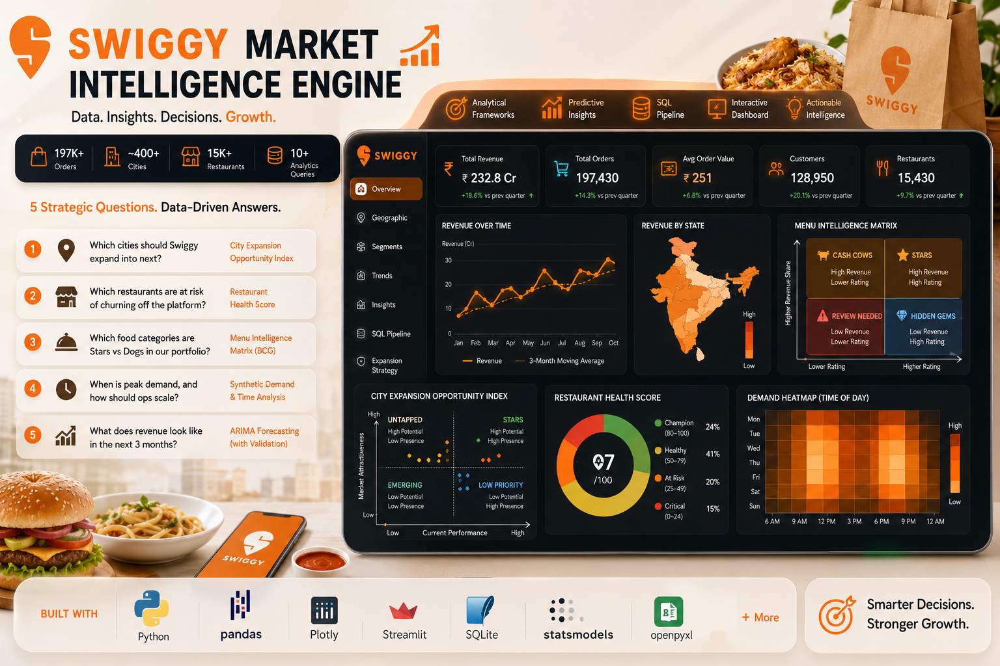
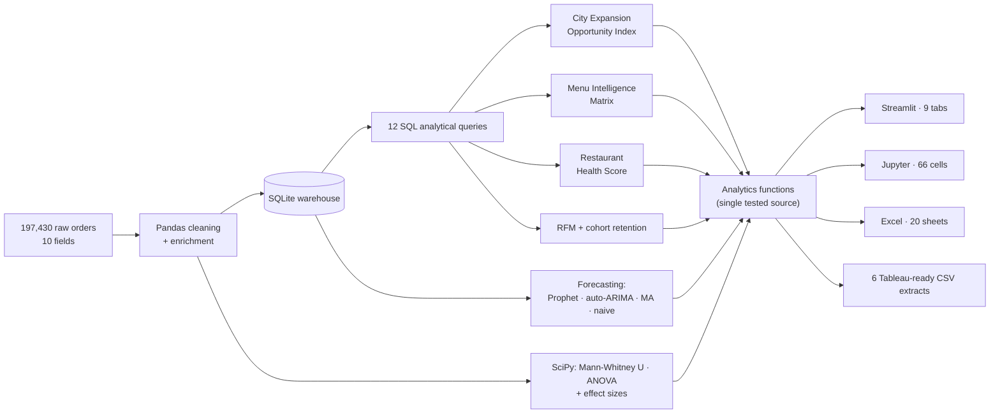
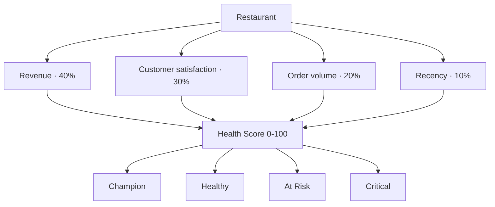

# 🍽️ Swiggy Market Intelligence Engine




> **Not just charts.** An independent decision-support analysis of **197,430 food-delivery orders**, built the way a growth team would actually use one.

> This is an independent, self-directed analytics project — not work performed for, commissioned by, or affiliated with Swiggy.

---

## Highlights

- Transformed **197,430 orders** across **10 fields** into a market-intelligence system answering **5 strategic questions**: expansion, churn risk, menu strategy, peak demand and the 3-month revenue outlook.
- Designed **3 proprietary analytical frameworks** — City Expansion Opportunity Index, Menu Intelligence Matrix and Restaurant Health Score — to convert raw orders into growth, category and partner-risk decisions.
- Built a **0–100 City Expansion Opportunity Index** from **4 weighted signals**: revenue growth **30%**, customer rating **25%**, order density **25%**, category diversity **20%**.
- Scored every restaurant **0–100** on a **Restaurant Health Score** weighting revenue **40%**, satisfaction **30%**, order volume **20%** and recency **10%**, sorting partners into Champion, Healthy, At Risk and Critical tiers so account teams know who to call first.
- Tested ratings and prices with **Mann-Whitney U** and **ANOVA**, then used **effect sizes** to separate statistical significance from practical significance: rating gaps by dish type, price tier and city were significant but negligible, while non-vegetarian dishes cost moderately more (median **INR 295 vs 200**).
- Compared **Prophet, auto-ARIMA, a 3-month moving average and naive** revenue forecasts on a **2-month holdout**, then selected the moving average for the 3-month outlook because it beat the more complex models at **1.29% MAPE** versus **1.88–3.07%**.
- Built a SQLite pipeline with **12 SQL queries** for monthly revenue, state and category revenue, top dishes, Pareto 80% cities, RFM segmentation and cohort retention.
- Generated **6 Tableau-ready CSV extracts** from the same tested analytics functions, so executive BI never re-implements the Python logic.
- Delivered one analysis through **3 consumption surfaces**: a **9-tab Streamlit dashboard**, a **66-cell Jupyter notebook** and a **20-sheet Excel KPI report**.
- Kept the analysis honest about dataset limits — no Customer ID and no real timestamps — by using restaurant-partner RFM and cohort retention and clearly labeling synthetic peak windows of **11–13** and **19–22**.

---

## Pipeline architecture



## How a partner gets scored



---

## Statistical findings

| Test | Result | Effect size | Read |
|---|---|---|---|
| Price: Veg vs Non-Veg | p < 0.001 | r = **0.36** | Medium — real and actionable |
| Rating: Veg vs Non-Veg | p < 0.001 | r = **-0.05** | Negligible |
| Rating by value tier | p < 0.001 | η² = **0.0011** | Negligible |
| Rating by city | p < 0.001 | η² = **0.0097** | Negligible |

**Forecast validation (2-month holdout):** 3-month moving average **1.29% MAPE** · auto-ARIMA 1.88% · Prophet 2.50% · naive 3.07%.

## Tech stack

**Analysis** Python · Pandas · NumPy · SciPy · statsmodels · scikit-learn
**Storage & SQL** SQLite · 12 analytical queries
**Forecasting** Prophet · auto-ARIMA · moving average · naive baselines
**Delivery** Streamlit · Plotly · Matplotlib · Seaborn · openpyxl (Excel) · Tableau extracts
**Quality** pytest · GitHub Actions

## Quick start

```bash
git clone https://github.com/Brijesh03032001/SwiggyAnalysis.git
cd SwiggyAnalysis
pip install -r requirements.txt
```

```bash
streamlit run app.py        # 9-tab dashboard
```

```bash
python -m scripts.build_excel_report    # 20-sheet KPI workbook
```

---

**Built by [Brijesh Kumar](https://github.com/Brijesh03032001)** · [Portfolio](https://brijeshbuilds.com) · [LinkedIn](https://linkedin.com/in/brijeshkumar03)
